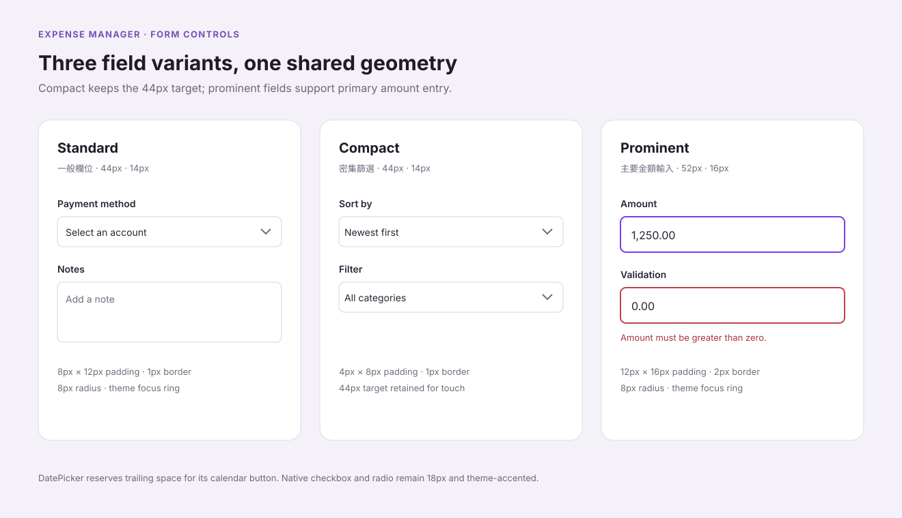
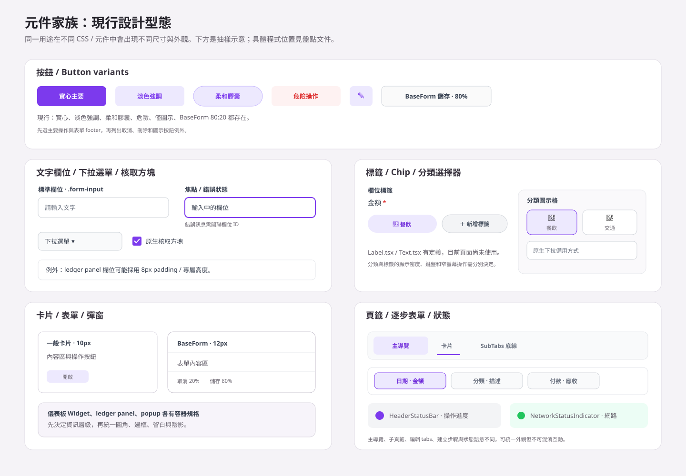
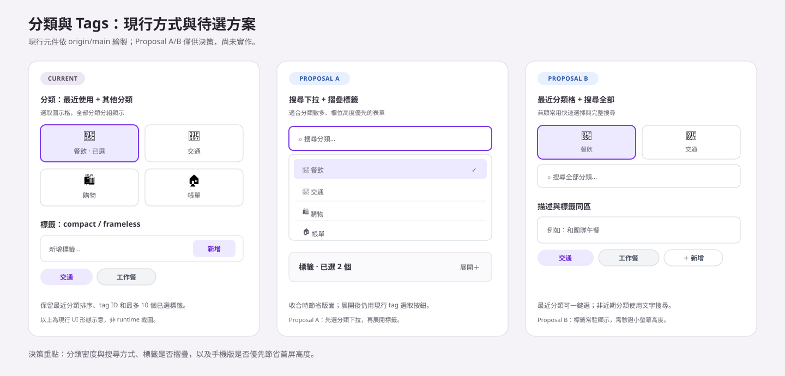
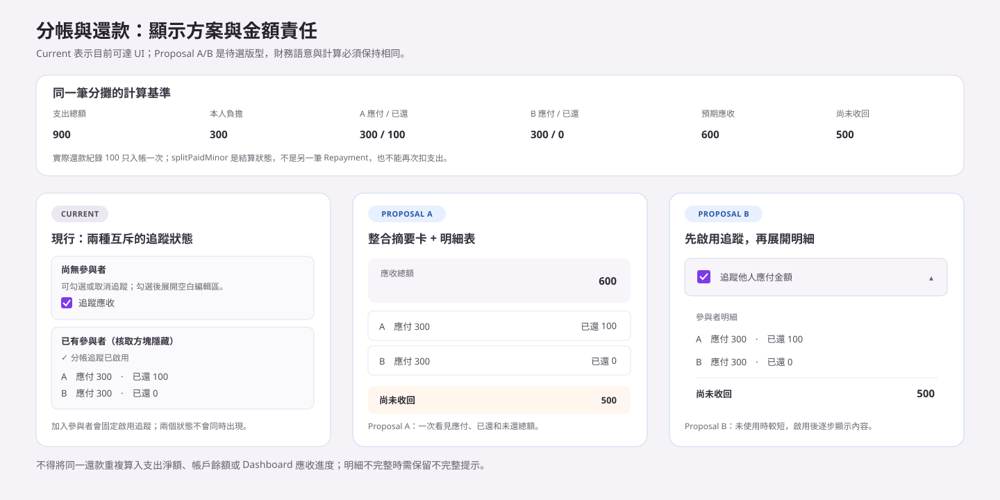
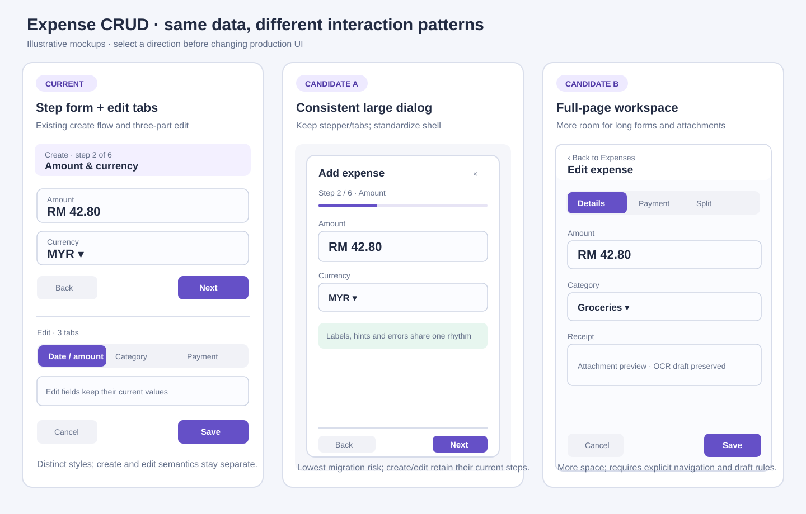
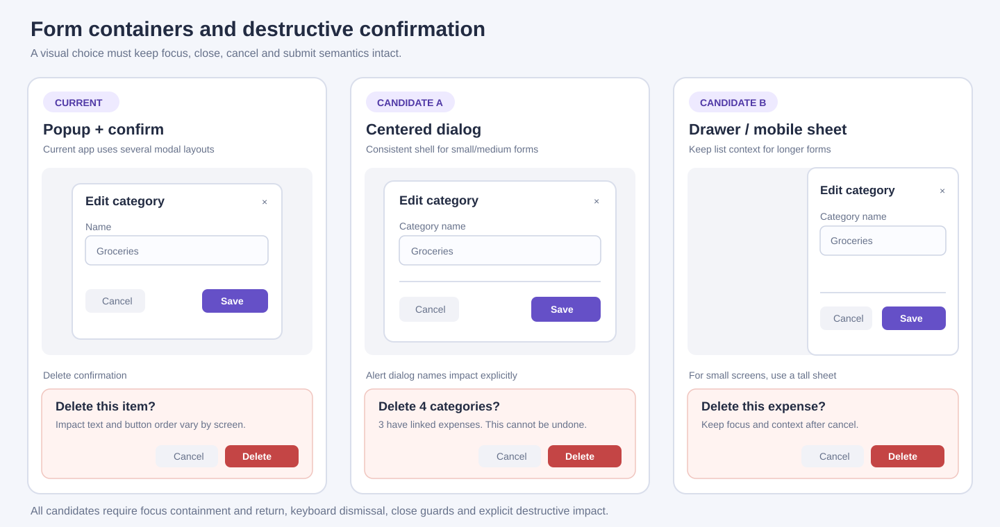
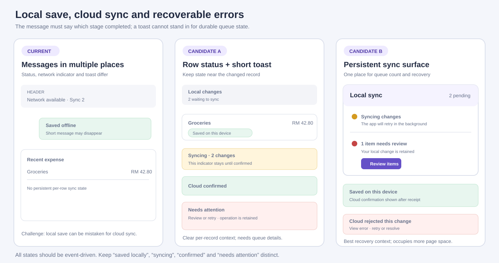

# Expense Manager UI 元件盤點與統一設計決策稿

> 程式碼盤點基準：`main@a9a9d7c`（2026-10-25）。此 commit 是改動前的 main 基線；目前逐頁實作記錄在 `codex/ui-standardization-inventory` 分支，尚未合併到 main。分支已為指定的表單/篩選/label/switch 元件新增命名變體並遷移部分 mounted screens；沒有涵蓋全站每個控制或重排互動流程。逐檔基線指標和分支變更摘要見 [樣式覆蓋矩陣](UI_STYLE_COVERAGE_MATRIX.md)。
> 預覽圖是 UI 規格的 SVG 示意，不是瀏覽器截圖。現有共用按鈕/欄位/卡片/dialog 基礎已載入；實際畫面仍可能被 component inline style、utility class 或功能 CSS 覆寫。分類選擇、流程版型、tabs 與 overlay 行為需在選定外觀時保留其互動意義。

## 1. 摘要

專案已有可重用的表單外框、輸入欄、按鈕、頁籤、彈窗與卡片樣式，但目前由全域 CSS、主題 CSS、Tailwind、元件 inline style 和專屬 CSS 同時控制。視覺差異主要出現在主要操作按鈕、表單 footer、卡片圓角/留白、表單欄位密度、頁籤和支出專屬元件。

目前可選的主題是 `light`、`dark`、`system`、`cat`、`cat-dark`。`system` 會跟隨作業系統，另有 system/serif/mono 字體和 small/medium/large 字級設定。`cat` 與 `cat-dark` 是 Warm Kitty 主題，覆寫一部分預設紫色樣式。

`ui-system.css` 在最後載入的共享層套用一般控制/按鈕/卡片/tab/dialog 幾何；TSX/CSS 仍保留能覆寫該層的 inline style、utility class 和功能樣式。新/改 UI 必須使用語意 token 和本文件的共享元件規格；既有尺寸差異要先判定為有意變體或無意偏差，不能僅因有 inline style 就批次刪除。

本文件同時保留 main 改動前現況、分支上的逐頁標準化範圍，以及尚未處理的互動候選。點開 [視覺統一規格](VISUAL_STANDARDIZATION_SPEC.md) 看共用尺寸與 preview，再看 [逐檔實作計畫](PATTERN_STANDARDIZATION_PLAN.md) 的邏輯界線和驗收範圍。分支實作限於呈現層；其他 CRUD/tab/drawer/category interaction proposal 不代表已改動互動行為。

### 預覽圖

**主題色彩預覽**：相同欄位、按鈕、標籤和卡片在四種已支援外觀中的示意。

**共用 UI 規格**：相同欄位、按鈕、checkbox、卡片和 dialog 在三種色盤共用尺寸/字級/radius tokens。

**欄位變體預覽**：Standard、Compact、Prominent 欄位的高度、字級和 padding 對照；Compact 仍保留 44px 觸控目標。

**元件樣式盤點**：改動前 `main@a9a9d7c` 的欄位、按鈕、容器、頁籤和選擇控制差異；搭配上方新欄位 variants 圖看分支已採用的欄位外觀。

**分類與 Tags 的現行/候選方式**：比較目前圖示格與兩種搜尋/收合方向。

**分帳與還款版型**：Current、Proposal A/B 使用相同金額資料，方便比較資訊層級。

**編輯與狀態呈現**：對照目前三分頁、候選四分頁，以及進度/網路狀態密度。

**新增/編輯/刪除流程**：對照目前支出 stepper/tabs、共用 dialog 和未採用的全頁 workspace 方向；互動草圖不代表 exact token 渲染。

**確認 dialog 與破壞性操作**：比較現行 modal、置中統一 dialog 和 drawer/sheet。

**同步狀態回饋**：區分本機保存、同步中、遠端確認和需處理操作。

更完整的功能 CRUD 入口及表單/overlay 流程見 [CRUD 流程盤點](CRUD_FLOW_AUDIT.md)；欄位、tabs、dialog/drawer 與狀態候選見 [互動模式候選](INTERACTION_PATTERN_CANDIDATES.md)；逐階段改動檔案和必須保留的資料邏輯見 [樣式標準化計畫](PATTERN_STANDARDIZATION_PLAN.md)。

## 2. 盤點範圍與方法

- 以目前 `origin/main` 上 `web/src` 的 TSX、CSS、Tailwind 設定和既有 UI 文件為準。
- 盤點「已掛載的頁面/功能」時以 `App.tsx` 和 `Dashboard.tsx` 的實際掛載為準；未掛載或舊版元件另外標示，不當作目前使用中的畫面。
- 靜態來源計數排除 `*.test.tsx`，不包含 runtime 條件、portal 展開內容、第三方元件內部節點，也不等於使用者看到的元件數。
- 統計約有 135 個非測試 `.tsx` 檔；常見 JSX 開啟標籤的靜態次數如下。標籤數不是元件數，也不表示每一個標籤都有相同樣式。
- 主要掛載證據以 `main@a9a9d7c` 為基準。使用者指定的既有 Expense_Manager plugin 已回報 `main`、`a9a9d7c`、`dirty=false`；此處不建立新 connector。若之後 main 前進，需先核對新 commit 再更新掛載狀態。

| JSX 標籤 | 次數 | JSX 標籤 | 次數 | JSX 標籤 | 次數 |
|---|---:|---|---:|---|---:|
| `div` | 1,380 | `span` | 571 | `p` | 194 |
| `label` | 154 | `button` | 343 | `input` | 133 |
| `select` | 52 | `textarea` | 7 | `form` | 8 |
| `section` | 17 | `nav` | 1 | `table` | 3 |
| `h1` | 6 | `h2` | 24 | `h3` | 50 |

全域及主題 CSS 分布在 10 個 CSS 檔；新增的 `web/src/styles/ui-system.css` 在 `index.css` 和 `cat-theme.css` 後載入，提供共享幾何/控制樣式。`index.css` 仍包含全域規則與功能局部樣式；讀取樣式時要一併檢查後置覆寫和主題選擇器。

## 3. 目前實際畫面與功能入口

### 路由與外層

`web/src/App.tsx` 掛載登入 `/`、舊 `/login` 轉址，以及登入後 `/dashboard`。Dashboard 的功能頁籤由 `web/src/pages/Dashboard.tsx` 以 `activeTab` 切換，不是各自獨立路由。`PWAInstallPrompt` 在應用外層提供安裝提示。

| 入口/畫面 | 目前內容 | 主要程式位置 |
|---|---|---|
| 登入 | 登入表單、驗證狀態及主題插圖 | `web/src/pages/Login.tsx`、`web/src/components/PrivateRoute.tsx` |
| Dashboard | 摘要、可排列 widgets、趨勢/圖表、快速新增與導向 | `web/src/pages/Dashboard.tsx`、`web/src/components/dashboard/`、`web/src/components/dashboard/widgets/` |
| Expenses | 日期/期間導覽、搜尋/篩選、支出清單、編輯、批次操作；`ExpenseList` 依狀態顯示分攤摘要並開啟還款表單 | `web/src/pages/tabs/ExpensesTab.tsx`、`web/src/components/expenses/` |
| Incomes | 收入表單與清單 | `web/src/pages/tabs/IncomesTab.tsx`、`web/src/components/income/` |
| Categories | 分類建立、編輯、排序與管理 | `web/src/components/categories/CategoryManager.tsx`、`CategoryForm.tsx` |
| Budgets | 預算、預算建議/歷史、收入連動設定 | `web/src/components/budgets/` |
| 導覽列的 Recurring | 實際掛載的是排程付款清單、月曆、分析 | `web/src/components/scheduledPayments/ScheduledPaymentManager.tsx`、`PaymentCalendarView.tsx`、`PaymentAnalytics.tsx` |
| Payment Methods | Cards、E-Wallets、Banks、Transfers 子頁 | `web/src/components/payment/PaymentMethodsTab.tsx`、`web/src/components/common/SubTabs.tsx` |
| Settings | 功能可見位置、排序與啟用設定 | `web/src/components/settings/FeatureManager.tsx` |
| Profile / Admin | 個人資料；管理員專用功能 | `web/src/pages/UserProfile.tsx`、`web/src/pages/tabs/AdminTab.tsx` |
| 全域狀態 | 同步/匯入/刪除進度、網路狀態、通知、載入、安裝提示 | `HeaderStatusBar.tsx`、`NetworkStatusIndicator.tsx`、`NotificationBell.tsx`、`InlineLoading.tsx`、`PWAInstallPrompt.tsx` |

### 元件實際掛載狀態（以指定 main commit 為準）

| 狀態 | 元件/功能 | 掛載證據與限制 |
|---|---|---|
| **Mounted** | Login、Dashboard、PWA install prompt | `App.tsx` 註冊 `/` Login、`/dashboard` PrivateRoute + Dashboard，並在 route 外掛載 `PWAInstallPrompt`。 |
| **Mounted / Conditional** | `CompactNavigation`、`DashboardMenuSection`、`FloatingExpenseActions`、`PopupModal`、`ConfirmModal`、`NotificationBell` | `Dashboard.tsx` 與實際功能管理元件直接引用；popup/confirm 只在指定互動狀態出現。 |
| **Conditional** | Dashboard 的各功能 tab | `Dashboard.tsx` 依 `activeTab` 和功能設定掛載 Dashboard、Expenses、Incomes、Categories、Budgets、Scheduled Payments、Payment Methods、Settings；Profile 由選單開啟，Admin 還受管理員權限限制。 |
| **Conditional** | `StepByStepExpenseForm` | `Dashboard.tsx` 的新增/收據入口、`ExpenseList.tsx` 的編輯入口會打開；不是每次 render 都顯示。編輯模式的 3 個 tabs 由 `editTabGroups` 組成。 |
| **Conditional** | `ExpenseSplitSummary`、`RepaymentForm` | `ExpenseList.tsx` 只在支出有 split participants 時顯示 summary；實際 repayment entry form 從 `ExpenseList` 的還款按鈕打開。主線沒有獨立 Repayments tab。 |
| **Conditional** | `HeaderStatusBar`、`NetworkStatusIndicator` | `HeaderStatusBar` 在匯入/刪除/重新驗證有狀態時才顯示；`NetworkStatusIndicator` 在 Dashboard 工具選單區呈現。兩者資料來源與互動不同。 |
| **Mounted / Conditional** | `ScheduledPaymentManager`、各 `*Manager` 的 `BaseForm` 子表單 | Dashboard 用 recurring feature key 懶載 `ScheduledPaymentManager`；支付方式、分類、預算、收入和設定頁依當前功能/操作打開其管理或表單。 |
| **Unmounted** | `ExpenseForm.tsx`、`TransferForm.tsx` | 元件定義存在，但 main app production TSX 沒有 consumer；目前支出建立/編輯使用 `StepByStepExpenseForm`，轉帳入口由實際掛載的 Payment Methods/Transfers 畫面處理。若後續重啟這些元件，須重新核對其資料行為。 |
| **Unmounted** | `FormPopup.tsx`、`Modal.tsx` | 有元件定義/示例，但 main app production TSX 沒有實際 consumer；目前共用 dialog 以 `PopupModal` / `ConfirmModal` 為主。 |
| **Unmounted** | `RepaymentManager.tsx`、`RepaymentList.tsx` | 管理器彼此引用，但沒有 main app production import；目前支出清單直接掛載 `RepaymentForm`，split summary 直接在 `ExpenseList` 顯示。 |
| **Legacy / Unmounted** | `RecurringTab.tsx`、`RecurringExpenseManager.tsx`、`RecurringForm.tsx` | `RecurringTab` 雖引用舊 Recurring manager，但 Dashboard 的 recurring tab 實際掛載 `ScheduledPaymentManager`。不能把舊畫面當成當前排程付款 UI。 |
| **Route unmounted** | `Register.tsx` | source file 存在，但 `App.tsx` 沒有 `/register` route；`/login` 轉址到 `/`。 |
| **Definition only** | `Label.tsx`、`Text.tsx` | 有元件定義；非測試 app source 沒有使用它們的 import/JSX，現有畫面仍主要用原生標籤、class 和 inline styles。 |

**BaseForm 的使用範圍：**來源中有 11 個直接消費者。依 main production 掛載鏈，8 個在目前可達畫面中可用（收入、預算、分類、銀行、電子錢包、卡片、排程付款、支出清單中的還款表單；都受頁面/操作狀態控制）；`ExpenseForm`、`TransferForm` 未掛載，`RecurringForm` 位於 legacy chain。僅做樣式統一時不要把 source-level consumer 數量誤當成 11 個已掛載畫面。

**版本差異說明：**既有 Expense_Manager plugin 現在已核對為乾淨 `main@a9a9d7c`；以上表格依該版本的 `App.tsx`、`Dashboard.tsx`、`ExpenseList.tsx` 和元件 import graph。主線實際 edit class 是 `.expense-edit-tabs`、`.expense-edit-tab` 和 `.expense-edit-tabpanel`。舊 branch checkout 的內容不作為本次 main 結論。

### 常用共用元件

| 類別 | 元件/檔案 | 目前用途與注意事項 |
|---|---|---|
| 表單外框 | `web/src/components/common/BaseForm.tsx` | source 有 11 個直接 consumer，其中 8 個在 main 掛載鏈可達；標題、關閉鈕、可捲動內容區與 footer 共用。按鈕寬度約 80/20，primary 為實心 accent。 |
| 彈窗/表單容器 | `PopupModal.tsx`、`ConfirmModal.tsx`、`FormPopup.tsx`、`Modal.tsx` | 目前頁面使用 `PopupModal` / `ConfirmModal`；`FormPopup` / `Modal` 有定義但目前無 production consumer。表單不是所有情況都由 BaseForm 包裝。 |
| 欄位/日期 | `DatePicker.tsx`、`TimePicker.tsx`、`CurrencySelector.tsx`、`PaymentMethodSelector.tsx`、`AutocompleteDropdown.tsx` | 日期、時間、幣別、付款方式與 autocomplete 各有專用互動和選取狀態。 |
| 導覽 | `CompactNavigation.tsx`、`SubTabs.tsx`、`DashboardMenuSection.tsx` | Dashboard 主導覽、功能內子頁籤與工具選單是三種不同用途/樣式。 |
| 文字/標題 | `PageTitle.tsx`、`SectionTitle.tsx`、`Label.tsx`、`Text.tsx` | `Label` 和 `Text` 有元件定義，但目前應用程式沒有找到使用處；目前多數頁面直接使用原生標籤、className 或 inline style。 |
| 載入/狀態 | `InlineLoading.tsx`、`HeaderStatusBar.tsx`、`NetworkStatusIndicator.tsx` | 載入動畫、同步/操作進度和網路狀態分開呈現。 |
| 表格/批次操作 | `MultiSelectToolbar.tsx`、支出列表/歷史列表 | 勾選列、批次操作與資料表格較局部，不能只套用一般卡片/表單規格。 |

`BaseForm` 的直接消費者與實際掛載狀態請以上方掛載矩陣為準；統一表單外觀時仍須保留每個可達畫面的欄位、提交回呼和驗證方式。

**Overlay 現況邊界：**目前 `PopupModal` 尚無 dialog ARIA 語意與 focus 管理；`ConfirmModal` 會先呼叫關閉 callback，再排程確認 callback。標準化時須以實際 consumer 的回呼語意重新設計，不能把候選互動當成目前行為。逐項證據見 [CRUD 流程與互動稽核](CRUD_FLOW_AUDIT.md)。

## 4. UI 元素類別與目前樣式

| 元素類別 | 目前表現 | 主要樣式來源/檔案 |
|---|---|---|
| 文字、標題、說明 | 原生 `h1`–`h6`、`p`、`span`、`div`；全域 heading 與靜態 inline/CSS font-size 使用 UI type tokens。通用 `Label`/`Text` definitions 仍不代表每個頁面已改用 wrapper。 | `ui-system.css`、`index.css`、`PageTitle.tsx`、`SectionTitle.tsx`、`Label.tsx`、`Text.tsx` |
| Label | main baseline 的 label 有 12px、13px、14px 層級；分支新增 14px primary 與 12px secondary 的語意 classes，已遷移本輪修改的表單/篩選畫面。 | `ui-system.css`、`index.css`、`Label.tsx`、各 `*Form.tsx` |
| Textbox / input | 原生 `<input>` 保留語意；分支提供 Standard 44px/14px、Compact 44px/14px、Prominent 52px/16px variants，並遷移本輪列出的 mounted fields。日期、幣別和 ledger 專用控制保留自己的組合。 | `ui-system.css`、`designTokens.ts`、`index.css`、表單元件 |
| Textarea / select | 原生 `<textarea>`、`<select>` 保留 native 行為和 textarea 擴展；分支已將 PaymentRecordForm、BudgetManager、ScheduledPaymentForm 等指定欄位接入 named variants。其他元件仍可能保留局部樣式。 | `ui-system.css`、`index.css`、PaymentRecordForm、BudgetManager |
| Checkbox / radio / toggle | 可見原生 checkbox/radio 為 18px theme accent；BudgetForm custom switch 保留原生 checkbox 狀態和鍵盤輸入，視覺 track 使用主題 token 與 focus ring。 | `ui-system.css`、`BudgetForm.tsx`、`ledger.css`、列表/設定元件 |
| Button | `.btn`、BaseForm、PopupModal、ConfirmModal 的 action 外觀沿用共同幾何；本輪 PaymentMethodSelector 與 ExpenseList 的指定動作接入 compact action；選擇 tile 仍有意保留專屬外觀。 | `ui-system.css`、`index.css`、`PopupModal.tsx`、`BaseForm.tsx`、`PaymentMethodSelector.tsx` |
| Card / panel / div container | `.card`、widget 和 tracked expense cards 共用 12px radius；純 layout `div` 不會一律加 surface/background。 | `ui-system.css`、`index.css`、`ledger.css`、`TrackedExpensesWidget.tsx` |
| Chips / tags | 分類 chip、已選標籤 chip、標籤選取按鈕、圖表 tag cloud；顏色、密度和交互狀態各異。 | `ExpenseTagPicker.tsx`、`ledger.css`、`ExpenseTagManager.tsx`、`TagCloudWidget.tsx` |
| 導覽 tabs | 主功能水平滑動 nav；`SubTabs` 底線樣式；支出編輯 tabs 的 selected 狀態；建立支出的逐步進度/前後導覽。 | `CompactNavigation.tsx`、`SubTabs.tsx`、`StepByStepExpenseForm.tsx`、`index.css`、`ledger.css` |
| Modal / dropdown / popover / bottom sheet | 現行 PopupModal/ConfirmModal 遮罩和內容框、autocomplete 下拉、日期快捷選單、Action Menu、PWA prompt 等浮層；source-only Modal/FormPopup 另列 unmounted。不同 z-index 與關閉/焦點方式。 | `PopupModal.tsx`、`ConfirmModal.tsx`、`Modal.tsx`、`AutocompleteDropdown.tsx`、`RadialDateMenu.tsx`、`Dashboard.tsx` |
| Feedback / status | 同步狀態和通知已有主題語意；表單錯誤文字/邊框、警告 role、欄位關聯及可重試操作仍分散於各表單。 | `InlineLoading.tsx`、`HeaderStatusBar.tsx`、`NetworkStatusIndicator.tsx`、`NotificationBell.tsx`、各頁元件 |
| Chart / data visual | 金額摘要、折線/圓餅/柱狀或趨勢圖與圖例；需保留 tooltip、圖例、縮放與數據缺漏說明。 | `components/dashboard/widgets/`、支出趨勢元件、Recharts |
| Icon / illustration | 通用 icon exports、emoji 分類圖示、貓咪插畫、卡片/付款方式圖示；圖示大小與背景形狀不一致。 | `components/icons/`、`CatIllustration.tsx`、各功能元件 |

## 5. 目前的樣式體系與差異

### 樣式來源

1. `web/src/index.css` 提供主色變數、全域規則、`.form-*`、`.btn-*`、卡片和頁面局部樣式。
2. `web/src/cat-theme.css` 保留 Warm Kitty palette、插畫與主題特有色彩；幾何由後載入的共同樣式層收斂。
3. `web/src/styles/ledger.css` 保留 ledger/支出標籤/receivable/編輯區等專屬版面與狀態。
4. `web/src/styles/ui-system.css` 統一共同尺寸/幾何/focus，並包含語意 token 和舊固定尺寸的 exact-value aliases。
5. `web/tailwind.config.cjs` semantic colors 讀取當前 CSS theme variables；spacing/font/radius 增加 ui token extensions。
6. React inline style 中固定 font-size、border-radius、padding、margin、gap 遷移到 tokens；資料驅動位置/尺寸、圖表設定和非幾何呈現仍保留在原元件。
7. `web/src/styles/designTokens.ts` 提供 TS runtime consumer 共用 UI token；`AutocompleteDropdown.tsx` 仍使用其 dropdown z-index。

來源盤點結論：改動前 main 的一般欄位並非全部一致。範例包括 BudgetManager 的 filter select、StepByStepExpenseForm 的 amount/一般欄位、AdminTab 的欄位、PaymentMethodSelector 的 labels，以及 `.form-label` 的 12px。分支為選定畫面建立 named variants 並遷移一部分局部 override；尚未改到的畫面仍依下方明細標示，不代表全站已完全一致。

### 已存在的外觀變體

| 元件 | 現有變體/數值 | 造成的差異 |
|---|---|---|
| 按鈕 | primary/secondary/danger/success/soft/pill/icon variants 還是保留；普通 action 共用 44px target、8px control radius、共用字級，icon action 36px。 | 顏色/用途不同；同類操作幾何一致。 |
| 表單欄位 | 改動前 main 有 44px global baseline 及多種局部 override；分支新增 standard/compact/prominent/date variants，仍有未遷移 screens 和 specialized controls。 | Standard 44/14，Compact 44/14 with tighter padding，Prominent 52/16，Date reserves calendar space。 |
| 標籤/驗證 | 分支提供 `.ui-form-label`、`--secondary` 和 `.ui-field-error`；只為本輪遷移欄位加上類別與可用的 `aria-invalid`，原始 label/error 關聯仍需逐畫面確認。 | Primary label 14px、secondary/error 12px；用 `htmlFor`/`id` 和 `aria-describedby` 維持可及性關聯。 |
| 原生 checkbox / custom switch | 可見原生選取控件為 18px theme accent；BudgetForm switch 使用 hidden native input 加 theme-aware track/focus。 | 保留原生 checked state、鍵盤行為及既有 handler；不把 switch 換成可點擊 div。 |
| 表單框架 | `BaseForm` header/body/footer，儲存:取消約 80:20；`PopupModal` footer 和自訂 Expense editor footer 不是同一布局。 | footer 按鈕位置、排列、比例會隨功能不同。 |
| 卡片 | 共用 `.card`/widget/功能卡 radius 12px；內容 padding 與 shadow 依卡片類型保留。 | 卡片幾何統一，資訊密度與財務資料排序不重排。 |
| tabs | CompactNavigation 為可橫向捲動的按鈕 nav；SubTabs 是底線 tabs；支出編輯是選取底色 tabs；建立支出是逐步流程。 | 目前有四種不同導覽語意，不能只改成一種 CSS 而不看用途。 |
| 顏色 | Purple light/dark 與 Warm Kitty light/dark 仍由原 theme variables 提供；共同樣式只讀取 semantic colors。 | 顏色、插畫與品牌色仍隨主題變化。 |
| 密度/形狀 | 靜態 spacing/radius 已改接 shared tokens；卡片、widget、dialog、控制項、chip 分別使用同一類幾何值。 | 內容 padding、列表密度、資訊排序及特殊資料卡版型保留；要改內容結構或密度仍需獨立產品決策。 |

### 已保留的程式差異

- 主次危險按鈕及 success/warning/status 顏色是語意變體，不合併為相同顏色。
- compact list/圖表/定位使用的動態尺寸/顏色不轉成固定值。
- `Label.tsx`、`Text.tsx` 仍是可重用 definitions；全域規格透過 CSS 控制已掛載原生元素，不要求把每個頁面重包 wrapper。

## 7.1 main 逐畫面一致性檢查清單

以下 source 狀態以 `main@a9a9d7c` 為改動前基線；「分支進度」列出 `codex/ui-standardization-inventory` 已接入 named variants 的範圍。未列入完成表示仍待逐頁確認或保留為另一個工作項目。SVG 是幾何示意，尚未代表每個螢幕的 computed-style/browser QA。

| 畫面 / 元件 | main baseline | 分支進度 |
|---|---|---|
| Login | 原生欄位有共用 baseline；驗證文字/錯誤呈現由 Login 局部管理。 | 本輪未改；留待獨立逐頁檢查。 |
| Dashboard / widgets | widget 卡片大致使用 shared layer；tracked expense card radius 有局部覆寫。 | Tracked expense card radius 接入 12px token；Dashboard customizer 數字欄位改用 compact variant。其餘 widget 未逐一重排。 |
| Expenses list / filters | filters 與 quick-preset 欄位有局部 padding/font；selection checkbox 為 native。 | filters 使用 compact；quick-preset 的標籤/欄位及 amount 欄位有明確 variants；保留原 selection 和提交行為。 |
| Expense create/edit | `StepByStepExpenseForm` 一般欄位、amount 欄位和描述 item 有不同尺寸；stepper、edit tabs、分類和 split 流程各有用途。 | 一般欄位/label 與描述 item 接入 shared variants；主要 amount 使用 prominent。分類 tiles、stepper、edit tabs、OCR 和 split flow 保留。 |
| Incomes | 收入欄位、label、error、amount 有局部差異。 | `IncomeForm` standard/prominent fields、error styling 和 `DatePicker` 組合接入；`IncomeList` 未改。 |
| Categories | reassign select 有局部幾何；CategoryForm 欄位需與共用規格對齊。 | `CategoryManager` select 與 `CategoryForm` fields/labels/errors 已接入；色彩選擇器保留 specialized native control。 |
| Budgets | filter/sort select、amount entry、switch 各有局部尺寸/顏色。 | `BudgetManager` filters/labels、`BudgetForm` standard/prominent/compact fields、keyboard-focusable theme-aware switch，以及 `BudgetTemplates` amount 欄位已更新。 |
| Payment Methods | text/select fields、labels 和 action button 有局部 variants；選擇 tile 有獨立語意。 | `PaymentMethodSelector` fields/labels/create actions 對齊 shared classes；選擇 tiles 保持原樣。 |
| Recurring / payment record | 篩選和 payment record 欄位有局部幾何。 | `ScheduledPaymentManager` filter、`ScheduledPaymentForm` fields/labels、`PaymentRecordForm` fields/labels 已接入；付款 handlers 不變。 |
| Profile / Admin | Profile reset-day 和 Admin fields 有局部尺寸。 | Profile reset-day 改用 compact；Admin fields 對齊 shared rules；權限及帳戶行為不變。 |
| Register (source-only) | `Register.tsx` 定義存在，但 `/register` 未在 `App.tsx` 註冊；Home.tsx 也不是 app route。 | fields 對齊 shared rules，作為未來重新掛載時的基線；目前不屬於可達畫面。 |
| Settings | Feature ordering numeric field 有固定窄寬。 | `FeatureManager` numeric field 使用 compact；保留 50px 寬和對齊方式。 |
| Labels / validation (cross-screen) | main 有多種 label type scale 和不同 error markup。 | 本輪修改表單以 primary/secondary label 和共用 error class 收斂；ARIA 關聯仍需逐欄位核對，未宣稱所有畫面完成。 |
| Autocomplete / date / currency | 日期/幣別/autocomplete 有內外層與原生互動差異；CurrencySelector 是有意尺寸變體。 | DatePicker 與 AutocompleteDropdown 共享 date/focus/label geometry。`AutocompleteDropdown` 有 3 個 mounted consumer：BudgetForm、ExpenseList quick-expense preset、ScheduledPaymentForm；legacy ExpenseForm/RecurringForm 仍未掛載。Consumer ID/name mapping、handlers 和 keyboard behavior 保留；CurrencySelector 未改。 |
| Dialog / global feedback | PopupModal/ConfirmModal 的 dialog ARIA/focus management 尚未完整；通知和欄位錯誤是不同來源。 | 本輪未修改 dialog focus/ARIA、global feedback flows。 |

本輪已完成分支列出的欄位、label、filter、switch 和 compact action 改動；amount entry、日期/幣別選擇器、分類 tiles、表格/清單密度、dialog focus/ARIA 與其他未點名畫面保留為明確例外或後續項目。不可將這份狀態表解讀成所有 controls 已逐頁 runtime 驗證。

## 6. 支出/還款特殊互動盤點

支出是最重要的表單例外，建立、掃描收據和編輯共用 `StepByStepExpenseForm.tsx`，但流程入口和編輯樣式不同：

- 建立支出以逐步表單操作日期、幣別/金額、分類、描述/標籤、付款方式與分攤追蹤；可先輸入收據並檢視 OCR 結果。
- 編輯畫面目前有 **3 個 tabs**：日期/金額、分類/描述、付款方式/應收追蹤；底部有取消和儲存。此功能和 `ledger.css` 中對應的 `.expense-edit-tab*` styles 都存在。
- 目前掛載的 `StepByStepExpenseForm` 分類選擇是「最近使用」和「其他」icon grid，並有 native select fallback；排序由 `categoryOrder` helper 管理。`ExpenseForm.tsx` 裡有 `AutocompleteDropdown` 版本，但此表單目前未掛載，應歸為 source-only variant，不能寫成當前主要畫面。
- `ExpenseTagPicker.tsx` 支援完整/compact/frameless 外觀；選取項目用 tag 按鈕表示，資料由 `useExpenseTags` 取得。已封存標籤若仍附在這筆支出上仍保留顯示/管理能力。
- `ExpenseSplitEditor.tsx`、`ExpenseSplitSummary.tsx` 和從 `ExpenseList.tsx` 開啟的 `RepaymentForm.tsx` 顯示分攤、應收和償還狀態。`RepaymentManager.tsx` / `RepaymentList.tsx` 是目前未掛載的舊管理鏈。`splitPaidMinor` 是分攤結算狀態，不應在 UI 重構時再次當作新增一筆 repayment。
- 日期快捷「Now」若搬動或改成新共用元件，日期和時間需由同一個時間快照取得，避免跨分鐘更新時產生不同時間。

以上視覺整理不得改變表單資料語意或財務計算。已存在的欄位 ID、owner、tag 關聯、分類排序、付款方式 ID、分攤參與者、回呼順序和錯誤處理都需要保持。

## 7. 已採用的共用外觀與保留模式

| 項目 | 已採用規格 | 狀態/範圍 |
|---|---|---|
| Primary/secondary/danger buttons | 保留依操作語意區分的實心/中性色/破壞性 variants；44px action target、8px radius、共用字級 | 已實作；按鈕 callback/type 未改 |
| 表單 footer | BaseForm 原有 80:20 ratio；按鈕尺寸與字型共用 | 已實作；自訂支出 footer 不重排 |
| 一般欄位 | native input/select 44px 最小高度；textarea 可增高；focus/radius/padding 使用 token | 已實作；日期/金額等原生語意保留 |
| Checkbox/radio | 原生控件、18px、accent theme color | 已實作；checked value 和表單提交未改 |
| Card/dialog | card 12px；dialog 16px；theme surface/shadow 保留 | 已實作；資料密度未重排 |
| Chips / badges | 語意維持原樣，統一 pill radius | 已實作 |
| 主題/字體 | Purple light/dark、Warm Kitty light/dark 保留；system/serif/mono 及 small/medium/large 設定保留 | 已實作；改用 semantic theme tokens |
| 分類/標籤選擇、分帳布局、支出 tabs、status entry | 保留當前可達 UI 與操作語意 | 不屬幾何標準化；未切換資料流程或重排功能流程 |

## 8. 逐階段檔案與邏輯計畫

共用 token 層與 native control/按鈕/卡片/dialog/tab 的 global baseline 已存在。分支實作完成本文件第 7.1 節所列範圍；以下各階段仍記錄可能擴大到其他畫面的檔案、邏輯邊界及資料契約。未完成項需先選定範圍再執行；interaction proposal 仍不代表已完成。

### 第 0 階段：main 基線與範圍

1. 改動前 audit 基於 `main@a9a9d7c`；既有 Expense_Manager plugin 已驗證該 snapshot 為 `branch=main`、`dirty=false`。本輪程式修改在 `codex/ui-standardization-inventory`，尚未合併；基線和實作差異分開列在本文件及覆蓋矩陣。
2. 採用第 7 節所列的 44px 控制、36px compact icon target、8/12/16px radius、rem type ramp 和既有紫色/Warm Kitty 色盤。
3. Dashboard、Expenses/Income/Budgets/Categories/Payment Methods/Scheduled Payments/Profile/Admin/Login 等 mounted screens 都載入共同 UI layer。
4. 分類/分帳/編輯 tabs/同步狀態的操作模式不因外觀而重選或重排；未來流程改版需另外記錄 viewport、語系與狀態矩陣。

### 第 1 階段：Token 和主題來源整理

**狀態：完成。** `ui-system.css`、TypeScript design tokens 和 Tailwind semantic colors/spacing/font/radius extensions 已建立；各主題值與 ThemeContext 設定沿用。

**檔案：**

- `web/src/styles/designTokens.ts`
- `web/src/index.css`
- `web/src/cat-theme.css`
- `web/tailwind.config.cjs`
- `web/src/contexts/ThemeContext.tsx`
- `web/src/components/ThemeToggle.tsx`、`ThemeToggle.css`

**已實作：**建立 semantic spacing/type/radius/control/shadow/focus/layer tokens；TypeScript UI tokens 與 Tailwind tokens 指向 CSS variables；dark 和 Warm Kitty 仍是同一套幾何規則下的 theme value set。

**邏輯注意：**保留 localStorage 舊值與 `system` 對作業系統主題變化的行為；保留 Warm Kitty manifest/icon 更新、字體設定與字級設定；明確保留 themeColor 與 `<meta name="theme-color">` 的外觀更新。新 token 不要讓舊主題值在初始化時閃一下。

### 第 2 階段：建立與使用共用基礎元件

**狀態：共用呈現完成；沒有新增 wrapper API。** 原生控制透過全域共用 CSS 規格，Label/Text/PageTitle/SectionTitle/SubTabs/BaseForm/PopupModal/ConfirmModal 靜態 style values 改接 tokens。

**基礎檔案：** `web/src/components/common/Label.tsx`、`Text.tsx`、`BaseForm.tsx`、`PopupModal.tsx`、`SubTabs.tsx`、`web/src/index.css`、`web/src/styles/ledger.css` 及新 `web/src/styles/ui-system.css`。目前沒有另建 Button/TextField wrapper，避免改動原生欄位提交 API。

**要做：**先固定 label/error/help text 的層級；欄位支援 label、required、hint、error、disabled、leading/trailing adornment；按鈕支援 primary/secondary/tertiary/danger/icon、loading/disabled；卡片和 modal 提供有意義的 variant，而不是靠任意 `div` class 命名。

**邏輯注意：**原生 input/select 的表單值、name、id、ref、`onChange`、鍵盤操作、瀏覽器 autofill 與 `aria-describedby` 要透過 wrapper 轉傳。Checkbox/switch 保留語意及 checked 值，視覺不要改成不可鍵盤操作的 div。暫時不要一次替換全部 133 個 input。

**先遷移目前掛載鏈可達的 BaseForm 消費者：**`IncomeForm.tsx`、`BudgetForm.tsx`、`CategoryForm.tsx`、`BankForm.tsx`、`EWalletForm.tsx`、`CardForm.tsx`、`RepaymentForm.tsx`、`ScheduledPaymentForm.tsx`。`ExpenseForm.tsx`、`TransferForm.tsx` 和 legacy `RecurringForm.tsx` 另列為未掛載元件；只有決定重新啟用時才納入遷移。調整每個 form 前先確認 submit/cancel/close/disabled 行為，避免提交按鈕重複觸發或取消誤提交。

### 第 3 階段：全域 shell、導覽和狀態元件

**狀態：全站共用 geometry 已生效；navigation/status layout 與來源未合併。**

**檔案：** `web/src/pages/Dashboard.tsx`、`web/src/components/navigation/CompactNavigation.tsx`、`DashboardMenuSection.tsx`、`FloatingExpenseActions.tsx`、`navigationConfig.ts`、`web/src/components/HeaderStatusBar.tsx` / `.css`、`NetworkStatusIndicator.tsx`、`NotificationBell.tsx`、`common/SubTabs.tsx`。

**要做：**統一頂部、主 nav、功能內子頁籤、工具選單、通知與新增 FAB 的高度、間距、顏色、focus/selected/hover/disabled 狀態。狀態列和網路狀態可統一視覺語言，但保留各自觸發條件與資訊來源。

**邏輯注意：**保留 `FeatureSettings` 的 `tabFeatures` / `hamburgerFeatures` 順序、舊 `enabledFeatures` fallback、Profile/Admin 可見權限、目前 `activeTab` 導向和手機 active item `scrollIntoView`。新增按鈕、長按日期快捷和收據掃描仍需互不遮擋。

### 第 4 階段：支出、收據、分類、標籤與分攤表單

**狀態：靜態 typography/spacing/radius tokens 與全域 native control styles 已套用；支出步驟、OCR、分類選擇及 split state 未重排。**

**目前掛載、可執行的檔案：** `web/src/components/expenses/StepByStepExpenseForm.tsx`、`ExpenseList.tsx`、`ExpenseFiltersBar.tsx`、`DateNavigator.tsx`、`PeriodPickerModal.tsx`、`ExpenseTagPicker.tsx`、`ExpenseSplitEditor.tsx`、`ExpenseSplitSummary.tsx`、`RepaymentForm.tsx`、`ReceiptAttachmentPanel.tsx`、`web/src/styles/ledger.css`。

**未掛載參考（不列入本階段執行範圍）：** `ExpenseForm.tsx`。只有產品決定重新啟用這個舊入口時，才把它加入遷移；不可為了統一外觀而平行改造未掛載的表單。

**要做：**先統一欄位、步驟進度、分類 tile/select、tag chips、receivable toggle、split participant、編輯 tabs、提交 footer，再調整 modal/list 和空/錯誤狀態。建立流程、OCR 收據確認與編輯流程分別檢查，不要以為一種畫面涵蓋全部。

**邏輯保護：**

- 不改變分類最近使用/其他分類排序和 category ID/name 對應。
- 不改變 tag ID、封存 tag 顯示規則、可選 tag 數限制和 `ExpenseTagPicker` 所接受的 `value`/回呼。
- 同時保留金額、幣別、日期、時間、付款來源、銀行/卡/電子錢包識別碼及 receipt attachment 狀態。
- 保留分攤份額校驗、幣別精度、參與者 ID、`needsRepaymentTracking` 和 `splitPaidMinor` 的既有語意；不由前端樣式層再推算/入帳一次。
- 保存/更新仍交由既有 submit handler 與 local-first/sync 流程處理；穩定 owner/document ID、outbox await、pending operation、receipt/重播防護與錯誤保留都不能因換 wrapper 而被跳過。

### 第 5 階段：清單、卡片和 Dashboard widgets

**狀態：mounted cards/widgets 共用 12px surface geometry；widget order、資料完整度、row density 與 chart semantics 保留。**

**目前掛載、可執行的檔案：** `web/src/components/dashboard/widgets/WidgetContainer.tsx`、各已掛載的 `*Widget.tsx`、`CustomizableDashboard.tsx`、`DashboardCustomizer.tsx`、`web/src/components/expenses/ExpenseList.tsx`、`TrackedExpensesWidget.tsx`、`IncomeList.tsx`、`BudgetManager.tsx`、`ScheduledPaymentCard.tsx`、`TransferList.tsx`、`AccountReconciliationManager.tsx`。

**未掛載參考（不列入本階段執行範圍）：** `components/repayment/RepaymentList.tsx` 與它所屬的舊管理鏈。只有產品決定重新掛載該管理頁時才另排遷移；目前可達的還款輸入是支出流程中的 `components/expenses/RepaymentForm.tsx`。

**要做：**定義資訊卡、操作卡、摘要卡、widget、資料列、empty/loading/error 的容器層級；將編輯/刪除 icon actions、badge、chips、金額和圖表標題套用統一規格。圖表視覺作為獨立子階段，避免同時重排圖表資料語意。

**邏輯注意：**保留 dashboard widget 顯示/排序設定、資料範圍完整度標示、導航 callback、最近支出排序、分期/排程付款狀態和帳戶核對互動。視覺改動不應導致每次操作都刷新整個 dashboard。

### 第 6 階段：其他頁面、登入和收尾

**狀態：所有 production TSX 載入共用 stylesheet，但只有部分檔案直接引用 tokens；改動前逐檔數字見 baseline 矩陣。本分支僅遷移第 7.1 節列出的 selected controls；source-only 元件不當作 current screen。**

**目前掛載、可執行的檔案：** `web/src/pages/Login.tsx`、`UserProfile.tsx`、`pages/tabs/AdminTab.tsx`、目前掛載的 `components/categories/`、`budgets/`、`payment/`、`banks/`、`cards/`、`ewallet/`、`transfer/`、`scheduledPayments/`、`importexport/`，以及 `common/DatePicker.tsx`、`TimePicker.tsx`、`CurrencySelector.tsx`、`PaymentMethodSelector.tsx`、`AutocompleteDropdown.tsx`、`MultiSelectToolbar.tsx`、`ConfirmModal.tsx`。

**未掛載參考（不列入本階段執行範圍）：** `components/repayment/RepaymentManager.tsx` / `RepaymentList.tsx`。`Register.tsx` 和 `RecurringTab.tsx` 也先確認產品是否重新啟用，再列入遷移。

**要做：**逐頁移除重複的 inline style/class variants；保留每個頁面既有資訊層級與功能，最後再刪除已無使用的舊 CSS。

## 9. 既有七項 UX 與 F17 的逐檔案計畫

本節記錄仍未重設的互動/流程候選，不代表本次已實作。共用 tokens 已存在，分支僅更新指定 field-family controls；若日後改分類搜尋、分帳布局、同步入口、支出 tabs 或 Now 按鈕，仍須先確認該候選的資料和行為變化，再分開改檔與驗收。

### UX-1（P1）：同步與離線狀態

- **目前行為：**`HeaderStatusBar.tsx/.css` 只在匯入、刪除或 revalidation 進度存在時出現，使用右下 42px 浮動圓鈕並可展開訊息；`NetworkStatusIndicator.tsx` 在 Dashboard 工具選單區另行呈現。offline queue/sync pending/error 由 `offlineQueue.ts`、`syncService.ts` 與 `DashboardMenuSection.tsx` 提供相關狀態，不能把「網路連線」等同「有無待同步操作」。
- **待選外觀：**保留獨立入口；整合成單一圖示入口；或圖示加短文字。預覽見 `previews/edit-status.svg`。
- **涉及檔案與邏輯：**`HeaderStatusBar.tsx/.css`、`NetworkStatusIndicator.tsx`、`DashboardMenuSection.tsx`、`Dashboard.tsx`、`syncService.ts`、`offlineQueue.ts`。先統一顏色、徽章、焦點和 aria-label，再評估 UI 是否顯示合併狀態；不同狀態仍由原資料來源決定。保留 error/dismiss、進度計數、離線待處理操作及重試入口。
- **驗收建議：**分別觸發匯入中、刪除錯誤、網路離線但 queue 空、網路在線但 queue 待處理、永久同步錯誤；使用者可辨識每種情況。

### UX-2（P1）：日期頁的 Now 快捷鍵

- **目前行為：**`StepByStepExpenseForm.tsx` 僅在日期不是今天時顯示 Now；點擊時建立一次 `const now = new Date()`，再以同一快照呼叫 `getTodayLocal(now)` 和 `getCurrentTimeLocal(now)` 更新日期與時間。新增支出 stepper 是目前掛載入口；`ExpenseForm.tsx` 不在 production 掛載鏈。
- **待選外觀：**沿用條件顯示；或固定顯示成小型輔助按鈕。若新增表單共用欄位，仍需使用同一個時間快照，避免日期跨午夜/跨分鐘時不同步。
- **涉及檔案與邏輯：**`StepByStepExpenseForm.tsx`、`web/src/utils/dateUtils.ts`、`common/DatePicker.tsx`、`common/TimePicker.tsx`；若重新啟用舊 `ExpenseForm.tsx` 再一併規劃。
- **驗收建議：**預設今天/非今天、跨午夜、不同日期格式、手機按鈕空間與鍵盤 focus。

### UX-3（P1）：分類圖示格、近期分類與搜尋

- **目前行為：**掛載的 `StepByStepExpenseForm.tsx` 使用最近分類/其他分類兩組圖示 tile，並提供 native select fallback；近期順序由 `utils/categoryOrder.ts` 管理。搜尋 `AutocompleteDropdown` 存在於未掛載的 `ExpenseForm.tsx`，不是目前建立/編輯支出流程的一部分。預覽見 `previews/category-tags.svg`。
- **待選外觀：**保留 icon grid；改用搜尋下拉；或近期分類 tiles 加完整清單搜尋。
- **涉及檔案與邏輯：**`StepByStepExpenseForm.tsx`、`utils/categoryOrder.ts`、`components/categories/CategoryManager.tsx`、`common/AutocompleteDropdown.tsx`。共用 picker 的結果需回填目前表單使用的 category 欄位和值，保留近期排序、選取狀態、預設分類和語系 label；除非另有資料遷移計畫，不將既有 payload 從 category name 悄悄換成 ID。
- **驗收建議：**無近期分類、很多分類、長分類名稱、搜尋無結果、最近項排序、不同語言與 320px 視窗。

### UX-4（P1）：Description 內的 Compact Tags

- **目前行為：**掛載的 stepper 在 Description 區使用 `<ExpenseTagPicker frameless compact>`；元件亦提供 framed/full、compact 及 frameless 外觀參數。選取值為 tag IDs。預覽見 `previews/category-tags.svg`。
- **待選外觀：**保留 inline chips；compact 控制先顯示已選數量、點擊展開；或分別規定表單與列表密度。
- **涉及檔案與邏輯：**`StepByStepExpenseForm.tsx`、`ExpenseTagPicker.tsx`、`ledger.css`、`expenseTagService.ts`、`useExpenseTags.ts`。保留 tag ID、最多 10 個已選標籤、標籤名稱長度、最多 100 個非封存 tag、封存但已附著 tag 的回顯、建立中狀態與使用者切換時的異步防護。
- **驗收建議：**0/1/10 個 tag、封存已附著 tag、重複名稱、建立失敗、載入失敗、展開/收合鍵盤操作。

### UX-5（P0）：分帳、應收、還款和完成狀態

- **目前行為：**`ExpenseSplitEditor.tsx` 顯示追蹤核取方塊、參與者/應付欄位、等分按鈕和本人負擔；`ExpenseSplitSummary.tsx` 顯示本人份額與 participant owed/paid/outstanding，金融資料未完整時顯示提示；`ExpenseList.tsx` 條件掛載 split summary，並直接打開 `RepaymentForm.tsx`。`RepaymentManager.tsx` / `RepaymentList.tsx` 雖在 repo 中，但目前未掛載。
- **核取方塊互動規則：**尚無參與者時，核取方塊的 checked 值對應 `needsRepaymentTracking`；勾選後展開空白參與者編輯區，取消勾選則收起。加入第一位參與者後，核取方塊會被「分帳追蹤已啟用」狀態文字取代；`enabled = trackingEnabled || value.length > 0`，提交時只要有參與者就強制保存 `needsRepaymentTracking = true`。移除最後一位參與者後會回到核取方塊；旗標通常仍為勾選，使用者可以保留舊式整筆應收追蹤或再關閉。已存在分帳還款時，`validateExpenseSplit()` 會阻擋移除/減少/改動參與者，需先反轉已連結的分帳還款。
- **已有還款時解除追蹤：**對沒有參與者的舊式應收，現行編輯器仍允許關閉核取方塊；`expenseService.update()` 沒有以還款記錄為條件阻擋這個旗標變更，也不會因取消追蹤而刪除還款或回復其帳戶移動。關閉後舊還款記錄仍存在，但該支出不再列為開啟中的應收。未來改版前需由產品選擇：允許保留歷史後解除追蹤，或在已有還款時禁止/加確認；不得讓 checkbox 外觀暗示會自動撤銷入帳。
- **圖例狀態說明：**`previews/split-repayment.svg` 的 Current 面板將「尚無參與者時可勾選」和「已有參與者時顯示已啟用狀態」並列作為兩種互斥狀態，不代表它們會同時出現在同一畫面。
- **資料責任：**`splitParticipants[].owedMinor` 是參與者的分攤計畫；本人份額 = 支出總額 − 其他參與者應付總額。`Repayment` 是實際還款事件，透過 expense/user 與 `splitParticipantId` 關聯。`splitPaidMinor` 是 `splitSettlementService.ts` 維護的 settlement/accounting 狀態，不是另一筆 repayment。沒有 participants 的舊式全額應收追蹤仍用 `repaymentTrackingCompleted` 手動完成；有 participants 時 open/outstanding 依 participant shares 與 linked repayments 計算。
- **算例（以單一幣別）：**支出 900；本人負擔 300；A 應付 300、已還 100；B 應付 300、已還 0；預期應收 600、實際已還 100、尚未收回 500。Dashboard widget、支出列表、還款表單和帳戶餘額不能把還款 100 再加一次或重複扣支出淨額。
- **待選外觀：**應收/分帳整合摘要卡；先打開追蹤再展開參與者；或保持目前編輯表單 + 列表摘要。預覽見 `previews/split-repayment.svg`。
- **涉及檔案與邏輯：**`ExpenseSplitEditor.tsx`、`ExpenseSplitSummary.tsx`、`RepaymentForm.tsx`、`ExpenseList.tsx`、`TrackedExpensesWidget.tsx`、`utils/expenseSplitCalculator.ts`、`services/repaymentService.ts`、`services/splitSettlementService.ts`、`services/balanceService.ts`、`Dashboard.tsx`。UI 改動只調整呈現和既有 handler，不自行重算/入帳；新增/修改 repayment 仍走原有 transaction 和 local-first contract。
- **驗收建議：**支出 900；本人負擔 300；A 應付 300、已還 100；B 應付 300、已還 0；剩餘應收 500。另驗多幣別 settlement、未分配還款、資料不完整、participant 已還款後防止移除/減少 share，以及刪除/編輯 repayment 時餘額與 splitPaidMinor 恢復正確。對 legacy 無參與者資料，明確驗證有既有還款時是否允許解除追蹤及其提示文案。

### UX-6（P1）：Dashboard 精準導向支出

- **目前行為：**Dashboard 的 `onOpenExpenseById` 將 Expenses 期間切到 all、切換 active tab 並設定 `focusExpenseId`；`ExpensesTab` 將 focus 傳給 `ExpenseList`；清單解除目標日期群組折疊，等目標列出現後 scrollIntoView 並短暫高亮。目標必須屬於當前使用者且已載入到清單。
- **待選外觀/行為：**保留原始期間並提供定位提示；或切到 all history 後定位；若該 ID 不在目前資料範圍/完整度未知，顯示可理解的找不到/載入中訊息，不應假裝已定位。
- **涉及檔案與邏輯：**`Dashboard.tsx`、`CustomizableDashboard.tsx`、需要導向支出的 `components/dashboard/widgets/*`、`ExpensesTab.tsx`、`ExpenseList.tsx`、`services/expensePeriodReadService.ts`、`historyService.ts`。保持 userId/expenseId 配對、期間資料完整度和既有排序/篩選語意。
- **驗收建議：**目標在當前期間、其他月份、已折疊日期群組、被 filter 隱藏、目前資料不完整、使用者不匹配或已刪除。

### UX-7（P1）：一般分頁式支出編輯

- **目前行為：**編輯入口由 `ExpenseList.tsx` 開啟 `StepByStepExpenseForm.tsx`，使用三組 tabs：日期/金額、分類/描述、付款方式/應收追蹤；新增流程仍是獨立 stepper。此 main commit 的 TSX 已渲染 `.expense-edit-tabs`、`.expense-edit-tab`、`.expense-edit-tabpanel`，`ledger.css` 有對應樣式。
- **待選外觀：**保留目前三分頁；增加附件成第四分頁；或改成單頁分區。Proposal 四分頁僅是草圖，還需確認附件在建立、掃描收據、編輯和 draft restore 中的資料行為。
- **涉及檔案與邏輯：**`ExpenseList.tsx`、`StepByStepExpenseForm.tsx`、`ReceiptAttachmentPanel.tsx`、`ledger.css`、`Dashboard.tsx`。保留 edit initial state、分頁切換、整體驗證、取消/儲存、receipt draft、payment IDs、split participants，以及由編輯開始時取用的 `revision`。
- **驗收建議：**從三個 tabs 來回切換不丟欄位；無效資料停用儲存；取消不寫入；receipt/split/付款資料往返不變；手機 tabs 可捲動且 focus 狀態清楚。

### F17：版本衝突保護（與支出編輯共同驗收）

F17 **不是完全沒有實作**：目前 `expenseService.update()` 已可在 Firestore transaction 比較 `expectedRevision` 和遠端 revision；`Dashboard.handleInlineUpdateExpense()` 已在 queue payload 保存 `expectedRevision`，`syncService` 會將它傳入更新。此功能仍需端到端驗收，不能因文件或 UI 完成就標記為 DONE。

- 表單開始編輯時保留該份 expense 的 revision；UI 排版/分頁改動不得把它丟掉或在切換 tabs 時重建錯誤版本。
- Offline queue 必須保留穩定 expense ID、owner ID、使用者未同步內容及 expected revision；同步時仍由 `syncService` 執行。
- 遠端 revision 不符時不得覆蓋新值或重複餘額調整；本地 pending edit 必須保留在可處理的 `needs-attention` 狀態，使用者可判斷本地/遠端內容再選擇。
- **涉及檔案：**`ExpenseList.tsx`、`Dashboard.tsx`、`services/expenseService.ts`、`services/syncService.ts`、`utils/offlineQueue.ts`、`utils/pendingOperations.ts`。依既有 mutation contract，queued remote mutation 的 immutable receipt 和 domain write 必須保持同一 transaction。
- **整合驗收建議：**開始編輯後其他裝置先更新、連續離線編輯同一支出、重新載入/重新登入後恢復 pending work、多分頁同時編輯、衝突後使用者重試/捨棄。這些是未來驗收建議；本次文件工作沒有執行測試。

## 10. 樣式實作狀態與後續驗收清單

本次 source baseline 使用 `main@a9a9d7c` 與既有 Expense_Manager plugin 唯讀核對；實作在 `codex/ui-standardization-inventory`。`npm run build` 和 `git diff --check` 通過。未執行 unit/component、Firebase Emulator 或 browser regression suite；SVG 預覽不能解讀為 runtime screenshot，分支也未合併到 main。以下 checklist 是仍需 browser/interaction QA 的項目。

- [ ] 四個色彩外觀及 system 跟隨行為正常；字體與字級設定保留。
- [ ] 每種主要控制能用鍵盤操作，focus 清晰；label 有關聯，錯誤/說明文字可由 assistive technology 取得。
- [ ] 320px、390px、768px、1280px 下欄位、modal、footer、tabs、chips 不溢出、不互相遮擋。
- [ ] zh-TW、zh-CN、en 長標籤和字級放大時不被裁切；輸入法/日期/數字欄位操作保留。
- [ ] Dashboard、支出建立/編輯/收據掃描、收入、預算、分類、付款方式、Profile/Admin、還款與排程付款畫面逐頁比對。
- [ ] 表單按鈕仍呼叫原 submit/cancel handler；欄位原值、驗證、錯誤、ID 和 callback 保持一致。
- [ ] 所有金融寫入仍先等待 local outbox 穩定接受，再顯示本地接受結果；遠端同步在背景執行，永久錯誤保留待處理操作。
- [ ] 排程付款、生成支出、帳戶變更和摘要仍在原有交易規則內；UI 重構沒有加入重複餘額調整。
- [ ] 清理 CSS 後搜尋確認無舊 class 消費者，也沒有由全域原生元素 selector 影響無關畫面。

## 11. 參考檔案

- [UI Style Guide](../UI_STYLE_GUIDE.md)：目前文件化的按鈕、卡片、導覽、響應式與無障礙規範。
- [UI Navigation Audit](../UI_NAVIGATION_AUDIT.md)：路由、實際功能入口、導覽現況與未來建議。
- [Features and Pages](../FEATURES_AND_PAGES.md)：產品功能頁面總覽。
- `web/src/App.tsx`、`web/src/pages/Dashboard.tsx`：路由和實際掛載依據。
- `web/src/index.css`、`web/src/cat-theme.css`、`web/src/styles/ledger.css`：目前主要視覺樣式來源。
