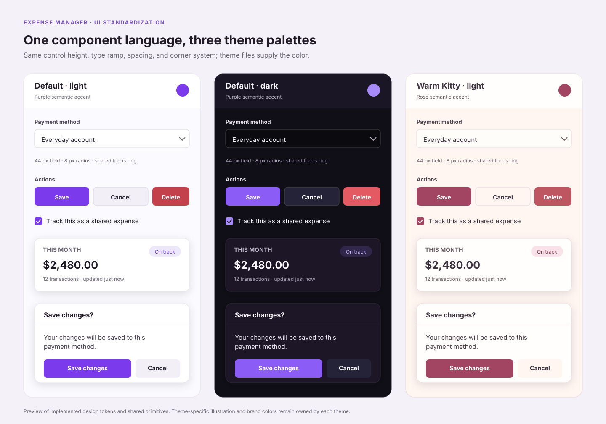

# UI 視覺統一規格

> 狀態：共用控制外觀、文字層級、圓角、spacing 與 focus baseline 已接入 app；部分 screen 的 inline style / utility 仍覆寫共用欄位與 labels，並非所有畫面已逐檔統一。預設紫色、dark 與 Warm Kitty 主題繼續提供各自的顏色。source audit 基準為 `main@a9a9d7c`（2026-10-25）；逐畫面差異與待選方案見 [元件盤點](UI_COMPONENT_INVENTORY_AND_PLAN.md)。

## 預覽

預覽顯示共用規格的幾何與色盤差異；它是 SVG 示意，不是執行中的瀏覽器截圖，也不代表 local overrides 已在每個畫面清除。所有 production TSX/CSS 的逐檔覆蓋數字見 [UI 樣式覆蓋矩陣](UI_STYLE_COVERAGE_MATRIX.md)。

## 共用規格

| 元件/屬性 | 已採用規格 | 執行來源 |
|---|---|---|
| 一般欄位 | input/select 44px 最小高度、共用 control padding、8px radius、14px action/body token、theme surface/border/focus | web/src/styles/ui-system.css |
| 多行文字 | 共用字級、色彩、border/radius/focus；最低高度為兩倍 control height，可繼續垂直伸展 | ui-system.css |
| Checkbox / radio | 保留原生 input type/value/keyboard；18px、accent 使用目前主題色 | ui-system.css |
| 一般按鈕 | 44px 最小互動高度、8px radius、共用 action 字級；primary/secondary/danger/success/warning 語意和既有色彩變體保留 | ui-system.css、index.css |
| Icon 按鈕 | 一般 icon action 至少 36px，close/menu 語意保留；pill/chip 使用全圓角 | ui-system.css |
| 一般卡片 / widget | 12px radius；既有內容、欄位與資料密度不重排 | ui-system.css |
| Popup / confirm dialog | 16px radius、共用 theme shadow；header/body/footer 原有結構保留 | PopupModal.tsx、ConfirmModal.tsx、ui-system.css |
| Tabs | 容器 12px，選項控制 8px；底線 tabs、nav、編輯 tabs、stepper 仍依原本互動語意呈現 | ui-system.css、SubTabs.tsx、各現有頁籤樣式 |
| 字級 | semantic rem type ramp；舊固定字級以 rem aliases 相容並跟隨 ThemeContext root scale | ui-system.css、designTokens.ts |
| 間距 | 新 UI 用 4px 主刻度及 2px 半刻度；已存在的固定值以 exact aliases 保存頁面版面 | ui-system.css、designTokens.ts |
| 色彩 | accent/text/surface/border/status 由現有 theme variables 決定 | index.css、cat-theme.css、tailwind.config.cjs |
| Focus | visible 2px accent outline 及 3px ring；尊重 reduced-motion | ui-system.css |

## 視覺來源與主題

- web/src/styles/ui-system.css 在 index.css 和 cat-theme.css 之後載入，提供跨主題一致的尺寸、圓角、字級、spacing alias、focus 和 control defaults。
- web/src/styles/designTokens.ts 對外提供 TypeScript 語意 token；Tailwind primary/danger/success/info/warning 顏色改為讀取當前主題變數，並提供 UI spacing/font/radius 延伸值。
- light、dark、system、cat、cat-dark 的存取值、System OS 變更監聽、Warm Kitty 插圖/manifest 行為，以及 system/serif/mono 和 small/medium/large 字體設定保持原樣。
- 舊 component 的資料驅動尺寸、位置、chart series/color、動態文字和條件化排版維持原控制；不使用全域規則把 layout div 一律變成卡片。

## 互動與資料邏輯界線

這次統一呈現外觀，不變更：

- Native input/select/textarea 的值、name/id/ref、onChange/onBlur、autofill、IME、數字/幣別精度與原生日期選擇語意。
- BaseForm、PopupModal、ConfirmModal 的現有 callback / submit / close 順序。ConfirmModal 仍先 onCancel，再排程 onConfirm；本次沒有新增焦點 trap 或 dialog ARIA 行為。
- tabs 選取、nav 導向、menu/dropdown keyboard 行為、category/tag 排序及支出新增/編輯流程。
- stable owner/document ID、writeLocalFirst/writeLocalFirstBatch、IndexedDB outbox、syncService、Firebase transaction、balance/summary side effect、read reconciliation 和 retry/replay。

若未來有 pattern 同時需要改互動或資料流程，應拆成獨立需求，依 AGENTS.md 和 docs/OFFLINE_SYNC_ARCHITECTURE.md 審查。

## 驗證狀態

- npm run build：TypeScript、Vite client build、PWA service worker build 通過；輸出只有 Browserslist / baseline-browser-mapping 資料過期提示。
- npx tsc --noEmit：通過。
- UI token 定義/引用檢查、SVG XML、Markdown 連結和 git diff --check：提交前檢查。
- 未執行 unit/component、Firebase Emulator 或 browser regression suite；此次改動是呈現層，沒有變更 app data mutation/read paths。

**後續 UI 開發必須依照** [UI Style Guide](../UI_STYLE_GUIDE.md)，逐檔覆蓋與目前差異見 [UI 元件盤點](UI_COMPONENT_INVENTORY_AND_PLAN.md)、[UI 樣式覆蓋矩陣](UI_STYLE_COVERAGE_MATRIX.md)、[逐階段計畫](PATTERN_STANDARDIZATION_PLAN.md)。
